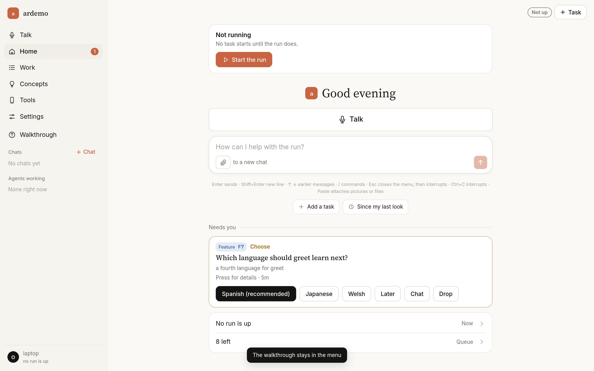
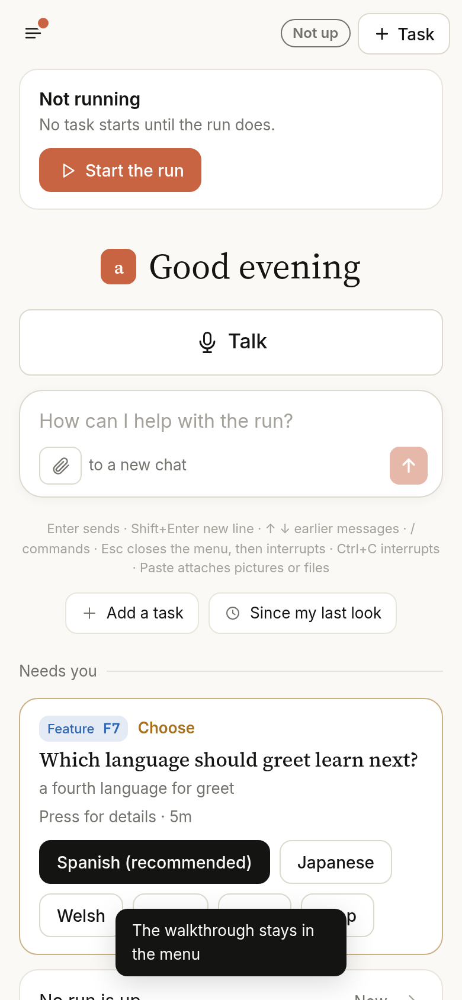
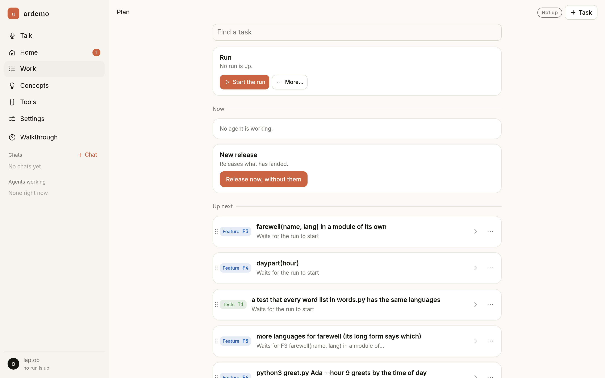
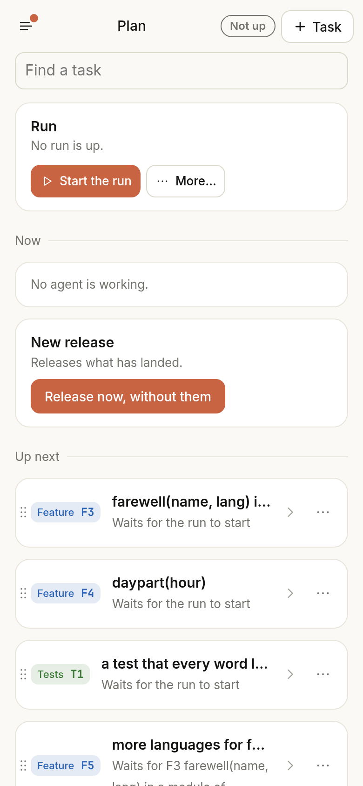

# agent-runner

<p align="center">
  <a href="https://github.com/FIZL0/agent-runner/releases/latest"></a>
  
  
  <a href="LICENSE"></a>
</p>

<p align="center"><b>Write a task list. Go to bed. Wake up to tested, merged commits.</b></p>

agent-runner runs several coding agents at once against a git repository and a plain markdown task list.
Each agent gets one task in its own git worktree. When it finishes, the runner tests its branch, merges it
and starts the next task. You run it all from a web app, on your phone or your computer: chat with it, answer
what it asks you, reorder the queue, and watch the agents work.

<p align="center">
  
  
</p>

- **Parallel without chaos.** Tasks that touch different files run side by side; tasks that share files,
  or wait on each other, never do.
- **Nothing untested reaches `main`.** Every finish and every merge goes through your test gate. A conflict
  gets a fix session, a broken merge a repair session; anything else waits for you.
- **Run it from anywhere.** One link reaches every project on the machine, from any phone or laptop on your
  network or tailnet. Several machines can work through the same plan at once.
- **Lean sessions.** Each agent starts from a short brief of its own task, not the whole plan: about
  [40% less context and half the tokens](#results).
- **Hands-off.** Usage limits, network drops, reboots and runaway tests are handled: work is paused, resumed
  or picked up again, never lost.
- **Zero setup.** Python 3.11 standard library only, one optional `runner.toml`. Sessions run on Claude Code
  by default, or on other providers such as GitHub Copilot ([Other providers](#other-providers)).

## Quick start

```sh
uv tool install git+https://github.com/FIZL0/agent-runner    # or: pipx install git+https://…
agent-runner home install          # Runner Home: one always-on page for this machine; prints a link and a QR code
agent-runner demo                  # an example project to try it on (~/agent-runner-demo); starts no agent
agent-runner home add ~/agent-runner-demo
```

Open the link (scan the QR code on your phone), open the example project, and follow its walkthrough: it shows
Home, the queue, a question waiting for you, and how to start the run. Then, in your own repo:

```sh
cd your-repo
agent-runner setup                 # backs up uncommitted work, writes runner.toml, and a session writes the test gate and a first plan
agent-runner run --dry-run 3       # what three agents would start right now, and why the rest wait
```

and press **Start the run** on its page. `agent-runner demo --remove` takes the example away again.
Installing into an existing repo, Windows, and wrapping it from your own CLI are in [docs/SETUP.md](docs/SETUP.md).

## The run app

Every project has a run app, served by the run itself (and by a small page-only process while no run is up,
so **Start the run** is always one tap away). It is laid out for a phone (the sidebar is a drawer) and for a
desktop.

- **Home.** A message box that starts a chat, a Talk button, shortcuts (Add a task, Since my last look), and
  **Needs you**: every question, approval or hand step the agents are waiting on, each with its answer
  buttons. A tap answers it; no terminal needed.
- **Chats.** Each chat is a real Claude Code session in the project's main checkout, shown live in the page.
  Ask it "status?", to pause, to add a slot, to queue a task, or to do one right now. A chat that ends on a
  question puts it under Needs you.
- **Talk.** Hands-free: tap the mic, speak, and the reply is read aloud.
- **Work.** The run's controls on top, then **Now** (what each agent works on and what merges), **Up next** (the
  queue, drag to reorder, a row folds open to its task), **Landed** and **Releases**, with one search over it all.
- **Concepts.** Pages of options an agent or chat drew up for you to choose between.
- **Tools.** Machines and test rigs the agents may use (a phone, a console, a server), with their keys kept
  out of every chat.
- **Settings.** The everyday settings, each with its control on its row, for the project or for this device
  only; Ask about my settings opens a chat that recommends changes.

<p align="center">
  
  
</p>

## Every device, every project

**Runner Home** (`agent-runner home install`) is one always-on page per machine. It lists every project in
`~/repos` with a `runner.toml` (`home add PATH` lists others), each running, idle or off, with what needs you
across all of them, and Start, Pause, Slots and Stop on each. Open takes you into that project's run app on the
same address, so one bookmark reaches them all. It starts at boot (systemd on Linux, launchd on macOS, a
scheduled task on Windows).

- **From your phone or another computer.** Home listens on port 8770 for devices on your network or
  [Tailscale](https://tailscale.com), behind a key in its link. With Tailscale it also sets up an https address,
  which Talk's mic needs. `agent-runner home trust add tailnet` lets your tailnet's devices in without the key.
  Never expose it to the internet: whoever opens it can do everything you can. On a phone, add it to the Home
  Screen and it opens like an app.
- **Every machine in one place.** Install Home on each machine you run agents on. Homes on one tailnet can
  find each other (or `agent-runner home peer add LINK` links one by hand), and Home's **Devices** shows every
  machine: its runs, CPU, memory, disk and temperatures, and what is using its room, with + slot and Clean.
  A full disk or a hot CPU shows under Needs you.
- **On several machines at once.** Run agent-runner on a desktop, a laptop and a server against the same repo:
  each run *claims* a task on the git remote before it starts it, so no two machines do the same work, and
  `agent-runner plan claims` shows who has what. Put the plan in [its own git repo](docs/REFERENCE.md#the-plan-in-its-own-repo)
  and every machine shares the plan itself too.
- **Per-device settings.** `runner.local.toml` (Settings → This device) overrides the project's settings on one
  machine: fewer agents on a laptop, a lower usage cap.

## How it works

The runner keeps a number of **slots** busy (3 by default). A slot is one agent on one task, in its own
git worktree and a hidden terminal.

```
plan/TODO.md
   │  pick the first task that may start
   ▼
slot N: worktree on task/<ID>, the agent works
   │  the agent runs `agent-runner done <ID> "msg"`: tests → tick → commit → push task/<ID>
   ▼
merge worktree: main + task/<ID> (+ other finished branches)
   │  a conflict → fix session · tests fail → repair session · tests pass ↓
   ▼
main moves and is pushed; the slot picks its next task
```

1. **Pick.** A free slot takes the first task in `plan/TODO.md` that may start: not blocked, not waiting
   on an `after:` task, and not sharing `files:` with work still running or not merged.
2. **Work.** The agent starts from a short brief: the task's line, its long form, the files it names, and its
   newest journal entry.
3. **Finish.** `done` runs your test gate, ticks the task, commits and pushes the branch, and refuses while
   the tests fail. An agent that needs you asks (`ask`, `done --blocked`), and the question shows under
   Needs you.
4. **Merge.** Merges are built in a separate worktree, so your checkout never holds an untested merge.
   Finished branches waiting their turn ride along in one test run. A conflict goes to a short fix session,
   a failing merge to a repair session; a batch that still fails is split. A task that cannot land in three
   tries is parked as `wip/<ID>` for you.
5. **Repeat.** When nothing can start the run waits; what you add later starts without a restart.

With `[run] approve`, landed work waits under Needs you as a pitch you approve before it is pushed.

## The task list

`plan/TODO.md` is ordinary markdown, and you rarely write it by hand: a chat files tasks for you, and the
Work view reorders them. Underneath it looks like this:

```markdown
### Next (in this order)

- [ ] **P12** the parser reads nested lists | files: src/parse.py, tests/test_parse.py
- [ ] **P13** maps too | files: src/parse.py | after: P12
  - [ ] **P13a** the empty map
- [~] **P14** a fuzz harness | files: tools/fuzz.py BLOCKED: needs both grammars
```

`[ ]` open, `[x]` done (moved to `DONE.md`), `[~]` blocked. `files:` decides what may run side by side,
`after:` what waits for what; a long description goes in `plan/tasks/<ID>.md`. Change it with
`agent-runner plan add|edit|move|note|drop …`, never by hand. The rules for order are in
`agent-runner help order`.

## Configuration

Every key is optional, and most are on the Settings page. A typical `runner.toml`:

```toml
[run]
test = "make test"                # the gate: run by every `done` and every merge
slots = 3
rules = "AGENTS.md"               # the file every session reads first
shared_files = ["CHANGELOG.md"]   # every task touches it: not counted as overlap
joinable = ["CHANGELOG.md"]       # and its conflicts are joined line by line
```

`agent-runner settings` lists every key; all of them are in the [reference](docs/REFERENCE.md#runnertoml).

### Other providers

For models Claude Code does not serve (GitHub Copilot, Codex and other logins), name the model as
`<provider>:<model>` in `[models]`, e.g. `code = "copilot:<model>"`, and log in once with
`agent-runner login copilot` (or from Settings). A project whose models all name another provider needs no
Claude Code at all. See [docs/SETUP.md](docs/SETUP.md#other-providers).

## Results

Measured over every slot session in opentennis and partyboard. **Before:** each session loaded the full
Claude Code setup and read the plan itself to find its task. **After:** a lean session (`[run] lean`, the
default) starts from its own brief.

| median per session | before | after |
|---|---|---|
| context at the first turn | 38k | **24k** |
| peak context | 165k | **107k** |
| tokens re-read over the session | 16.3M | **7.4M** |

<sub>Before: opentennis, 212 sessions, 7–11 Oct 2026. After: opentennis and partyboard, 497 sessions,
19 Oct–16 Nov 2026.</sub>

`agent-runner cost` shows where the remaining tokens go, by kind of tool call.

## Working with it well

- **Small tasks that name their files.** One session, one task, one commit; split anything bigger.
- **A real test gate.** `[run] test` is the only thing between an unattended agent and `main`.
- **Keep the rules file small.** It is re-read on every turn of every session; `agent-runner context` shows
  what each session loads.
- **Say it, don't fix it.** Tell a chat what you saw in your own words; it finds the files and queues the task
  for the next free agent. Say "do it here" when you want it done in that chat now.
- **Start small.** One or two agents first. Usage limits are per account: five agents spend them five times as
  fast, and the weekly and 5-hour caps in Settings hold new tasks before you run out.

## Used by

- **[opentennis](https://github.com/FIZL0/opentennis)**: a PS2 game remaster, one PCSX2 per slot.
- **[partyboard](https://github.com/FIZL0/partyboard)**: a Mario Party 4 port with online play.
- **[ps2-decomp-kit](https://github.com/FIZL0/ps2-decomp-kit-linux)**: a PS2 decompilation kit, wrapping it
  as `./kit run`.
- **[openmx](https://github.com/FIZL0/openmx)**: a PS2 game port built on the kit.

## Documentation

| | |
|---|---|
| [docs/SETUP.md](docs/SETUP.md) | installing, Windows, other providers and logins, adding it to a repo, wrapping it from your own CLI |
| [docs/REFERENCE.md](docs/REFERENCE.md) | the run app, Runner Home, picking, merging, claims, every command and setting |
| [docs/STYLE.md](docs/STYLE.md) | how the run app looks, moves and speaks: read it before changing the page |
| [CHANGELOG.md](CHANGELOG.md) | what changed in each version |

Upgrade any time with `agent-runner upgrade`: a run that is up restarts on the new version and keeps its work.
