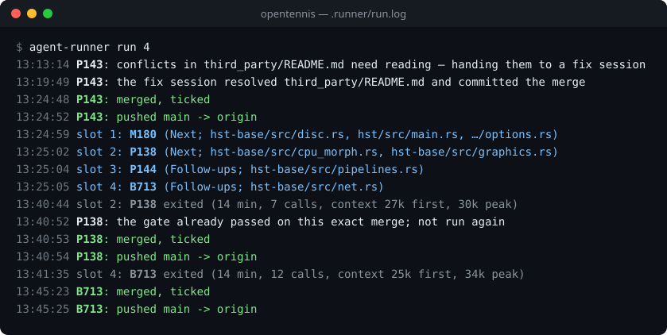

# agent-runner

<p align="center">
  <a href="https://github.com/FIZL0/agent-runner/releases/latest"></a>
  
  
  <a href="LICENSE"></a>
</p>

<p align="center"><b>Write a task list. Go to bed. Wake up to tested, merged commits.</b></p>

agent-runner runs several coding agents at once, unattended, against a git repository and a plain markdown
task list. Each agent gets one task, in its own git worktree and terminal. When it finishes, the runner
tests its branch, merges it, pushes, and starts the next task. Sessions run on Claude Code by default, or on
[Pi](#other-providers) for other providers.

- **Parallel without chaos.** Tasks that touch different files run side by side; tasks that share files,
  or wait on each other, never do.
- **Nothing untested reaches `main`.** Every finish and every merge goes through your test gate. A
  conflict gets a fix session; a broken merge gets a repair session; anything else waits for a human.
- **Lean sessions.** Each agent starts from a ~1k-token brief of its own task, not the whole plan: about
  [40% less context and half the tokens](#results) of a session that reads the plan itself.
- **Hands-off.** Usage limits, network drops, reboots and runaway tests are all handled: work is paused,
  resumed or adopted, never lost.
- **Zero setup.** Python 3.11 standard library only, one optional `runner.toml`, and nothing for the repo
  to install.

<p align="center">
  
</p>

## Quick start

```sh
uv tool install git+https://github.com/FIZL0/agent-runner    # tracks main; or: pipx install git+https://…
cd your-repo
agent-runner plan                  # what the runner sees in plan/TODO.md
agent-runner run --dry-run 3       # what three slots would start right now, and why the rest wait
agent-runner run once              # one task, one session, then stop: try it like this first
tmux new -s runner agent-runner run 3
```

> [!TIP]
> No repo handy? `examples/demo.sh` builds a tiny one with a plan in a temp dir and shows `plan`,
> `plan brief` and `run --dry-run` without starting an agent. `examples/demo.sh --run` also does one real task.

Upgrade with `uv tool upgrade agent-runner` (or `pipx upgrade`) once the current run has finished, or pin a
[release](https://github.com/FIZL0/agent-runner/releases/latest): `uv tool install git+https://github.com/FIZL0/agent-runner@v<version>`.
On Windows, run `agent-runner run 3` directly: each slot gets a Windows Terminal tab instead of a tmux pane.
Adding it to an existing repo and wrapping it from your own CLI are in [docs/SETUP.md](docs/SETUP.md).

## How it works

```
plan/TODO.md ──pick──▶ slot N: worktree ~/runs/<repo>/sN on task/<ID>, a tmux pane running the agent
                         …the agent works, then `agent-runner done <ID> "msg"`: test gate → tick → commit → push
               ◀─merge── merge worktree: main + task/<ID>, fix session for real conflicts, test gate again
                         → land in your checkout → reopen what it unblocked → push main
```

1. **Pick.** A free slot reads `plan/TODO.md` from the top and takes the first task it's allowed to start.
2. **Start.** The slot gets a worktree on `task/<ID>` and a terminal (a tmux pane; a Windows Terminal tab
   on Windows) running the agent, with a prompt and the task's brief: its line, its long form, the files
   it names, and the newest journal entry.
3. **Finish.** The agent runs `done`, which runs the test gate, ticks the task, commits and pushes the
   branch. If it's stuck it runs `done --blocked "why"` instead. A quiet session is then ended.
4. **Merge.** In a separate worktree the runner merges the branch, merges the task list by task and joins
   conflicts in files you list (a changelog) line by line, hands real conflicts to a fix session, and runs the gate again. Only a tested
   merge moves your checkout, and `main` is pushed.
5. **Repeat.** Unblocked tasks reopen on their own. When nothing can start, the run idles and picks up
   whatever you commit to TODO.md next.

Stop gently with `s` + Enter in the runner's pane (or `agent-runner stop`): nothing new starts, running
tasks finish and merge, then it exits.

## The task list

`plan/TODO.md` is ordinary markdown. The runner reads task lines under `###` headings:

```markdown
### Next (in this order)

- [ ] **P12** the parser reads nested lists | files: src/parse.py, tests/test_parse.py | test: test_parse
- [ ] **P13** maps too | files: src/parse.py | after: P12
  - [ ] **P13a** the empty map
- [~] **P14** a fuzz harness | files: tools/fuzz.py BLOCKED: (after P12, P13) needs both grammars

### Stretch

- [ ] **P99** nice to have: a run never starts this section
```

- `[ ]` open, `[x]` done (moved to `DONE.md`), `[~]` blocked. Only the tool changes a box: use
  `agent-runner plan add|tick|block|note|move …`, never edit one by hand.
- `files:` lets two tasks run side by side when they don't overlap, and puts those files in the brief.
  `after:` holds a task until every id listed is done. Prose is never parsed for either.
- `P13a` is a subtask of `P13`: a family never runs two tasks at once.
- A long description goes in `plan/tasks/<ID>.md`, which the brief uses in place of the line.

To make one task wait for another, say it in a way the runner reads:

| to make B wait for A | do this |
|---|---|
| B is part of A's work | `plan add A12 "…"` gives subtask `A12a` |
| B needs A merged first | `after: A12` on B's line, or `plan block B3 --after A12 "why"` |
| a list that must go in order | a section heading containing *in this order* or *one at a time* |

The plan can also live in [its own git repo](docs/REFERENCE.md#the-plan-in-its-own-repo), shared by every
machine, with claims so two people can run against it at once.

## Configuration

Every key is optional. A typical `runner.toml` for a parallel project:

```toml
[plan]
journal = "journal"           # per-task notes; the newest goes into a retry's brief

[run]
test = "make test"            # the gate: run by every `done` and every merge
slots = 3
rules = "AGENTS.md"           # the file every session is told to read first
shared_files = ["CHANGELOG.md"]   # every task touches it: don't count it as overlap
joinable = ["CHANGELOG.md"]       # and join its conflicts line by line
```

`runner.local.toml`, created for you and kept out of git, overrides it on one machine (fewer slots on a
laptop, a lower usage cap). Every key is in the [reference](docs/REFERENCE.md#runnertoml).

### Other providers

For models Claude Code doesn't serve (GitHub Copilot, Codex, other provider logins), set `backend = "pi"`
to run sessions on [Pi](https://www.npmjs.com/package/@earendil-works/pi-coding-agent), or try it once with
`AGENT_RUNNER_BACKEND=pi agent-runner run once`. Pi sessions still run the repo's Claude Code PreToolUse
hooks. See [Pi and enterprise Copilot](docs/SETUP.md#pi-and-enterprise-copilot).

> [!NOTE]
> Pi on an Anthropic model bills that account's extra usage, not the plan, so keep Claude models on
> Claude Code.

## Results

Measured over every slot session in opentennis and partyboard. **Before:** each
session loaded the full Claude Code setup (MCP servers, user settings) and read the plan itself to find
its task. **After:** a lean session (`[run] lean`, the default) starts from its own brief.

| median per session | before | after |
|---|---|---|
| context at the first turn | 38k | **24k** |
| peak context | 165k | **107k** |
| tokens re-read over the session | 16.3M | **7.4M** |

<sub>Before: opentennis, 212 sessions, 7–11 Oct 2026. After: opentennis and partyboard, 497 sessions,
19 Oct–16 Nov 2026.</sub>

On opentennis, five slots in parallel against a 200k window, that is the difference between sessions that
ran out of room mid-task and sessions that finish with half the window to spare. `agent-runner cost` shows
where the remaining tokens go, by kind of tool call.

## Working with it well

- **Small tasks that name their files.** One session, one task, one commit. Anything bigger than an
  afternoon of human work should be split into subtasks first.
- **A real test gate.** `[run] test` is the only thing between an unattended agent and `main`: fast enough
  to run on every finish and merge, strict enough that you trust it.
- **Keep the rules file small.** Your rules file, CLAUDE.md and AGENTS.md are re-read on every turn of every
  session, and agents keep adding to them. Put code maps and how-tos in `[plan] lookup` files instead, one
  `## section` each, which agents fetch with `agent-runner plan <heading>`. `agent-runner context` shows what
  every session loads against a 12 KB budget (`[plan] context_kb`).
- **Order only what must be ordered.** An *in this order* section runs one task at a time; a plain
  section starts tasks side by side whenever their files don't overlap.
- **Start small.** `once`, then 2 or 3 slots. More only helps when the plan has that many tasks on
  different files, and usage limits are per account: five slots spend them five times as fast.

After a run, `.runner/ledger.md` has one line per branch (merged, blocked, or **left for a human, and
why**), `agent-runner plan` shows what's blocked, and `git branch --list 'wip/*'` lists branches that
couldn't be merged.

## Used by

- **[opentennis](https://github.com/FIZL0/opentennis)**: a PS2 game remaster, one PCSX2 per slot.
- **[partyboard](https://github.com/FIZL0/partyboard)**: a Mario Party 4 port with online play.
- **[ps2-decomp-kit](https://github.com/FIZL0/ps2-decomp-kit-linux)**: a PS2 decompilation kit, wrapping it
  as `./kit run`.
- **[openmx](https://github.com/FIZL0/openmx)**: a PS2 game port built on the kit.

## Documentation

| | |
|---|---|
| [docs/SETUP.md](docs/SETUP.md) | installing, Windows, Pi, adding it to a repo, wrapping it from your own CLI |
| [docs/REFERENCE.md](docs/REFERENCE.md) | picking, merging, fix and repair sessions, disk and memory limits, CI, the prompt, every command and config key |
| [docs/AGENTS-EVAL.md](docs/AGENTS-EVAL.md) | which other terminal agents could become backends |
| [CHANGELOG.md](CHANGELOG.md) | what changed in each version |
